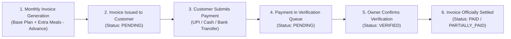

# MessMate – Billing & Payment Management Guide (बिलिंग व पेमेंट मार्गदर्शिका)

**Business**: Baramati Messwala (बारामती मेसवाला)  
**System Module**: Monthly Invoicing, Payment Verification, and UPI Reconciliation  

---

## 1. Billing Lifecycle Overview

---

## 2. Invoice Generation & Fee Calculations

Invoices are generated automatically on a monthly cycle or on-demand by the mess owner:

$$\text{Total Invoice Amount} = \text{Base Plan Fee} + \text{Extra Meal Charges} + \text{Guest Meal Charges} - \text{Discount Amount}$$

$$\text{Balance Due} = \text{Total Invoice Amount} - \text{Paid Amount}$$

### Invoice Status Values:
- **`PENDING`**: Invoice generated, payment awaiting submission.
- **`PARTIALLY_PAID`**: Partial payment verified; remaining balance still due.
- **`PAID`**: Full balance verified by Owner. Balance due is zero.
- **`OVERDUE`**: Payment due date has passed without full settlement.

---

## 3. Strict "Confirm Paid" Business Rule

To maintain financial integrity:
1. **No Customer Self-Settlement**: A customer cannot mark their own invoice as `PAID`.
2. **Customer Submission State**: When a customer submits a UPI payment with UTR number, the payment record is saved as `PENDING`. The invoice balance remains unchanged until the owner confirms receipt.
3. **Owner Verification Trigger**: When the owner verifies the payment via `/admin/payment-management`, the backend atomically:
   - Updates payment status to `VERIFIED`.
   - Records `verifiedById` and `verifiedAt`.
   - Increments invoice `paidAmount`.
   - Decrements invoice `balanceDue`.
   - Sets status to `PAID` (if balance is ₹0) or `PARTIALLY_PAID`.

---

## 4. Admin Payment Management (`/admin/payment-management`)

### 4.1 Confirming Online / UPI Payments
1. Go to **पेमेंट मॅनेजमेंट** (`/admin/payment-management`).
2. Review the **पडताळणी प्रलंबित (Pending Verification)** queue.
3. Check the customer's name, submitted amount, payment method, and **UPI Reference / UTR Number**.
4. Cross-check with your UPI business app (Google Pay / PhonePe / Paytm / Bank statement).
5. Click **प्रमाणित करा (Verify)** $\rightarrow$ The invoice status immediately updates to `PAID`.

### 4.2 Recording Direct Cash Payments (रोख भरणा)
1. In the **थकबाकी असलेले ग्राहक (Outstanding Due)** table, locate the customer.
2. Click **पेमेंट जमा करा (Record Payment)**.
3. Enter amount received (₹), select **CASH (रोख रक्कम)**, add optional reference notes.
4. Click **पेमेंट जमा करा**.
5. The cash payment is recorded with status `VERIFIED` and the invoice is updated.

---

## 5. Bulk Payment Reminders

- Tapping **सर्वांना स्मरण पाठवा** in the admin dashboard sends a reminder announcement to all customers with overdue balances.
- Customers receive in-app notifications prompting them to clear their monthly mess dues.
