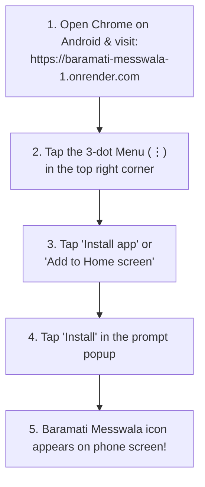

# MessMate – Progressive Web App (PWA) Mobile Installation Guide

**Business**: Baramati Messwala (बारामती मेसवाला)  
**App Type**: Progressive Web Application (PWA) for Android, iOS & Desktop  
**Live Application URL**: `https://baramati-messwala-1.onrender.com`  

---

## 1. What is MessMate PWA?

MessMate is packaged as an installable **Progressive Web App (PWA)**. It provides a native mobile app experience without needing an app store download:
- Installs an official Baramati Messwala app icon on your home screen.
- Runs in fullscreen without browser URL bars or navigation clutter.
- Cached offline assets for fast loading.
- Instant access to camera QR scanning and dining passes.

---

## 2. Android Phone Installation (Chrome / Brave / Edge)

1. **Open Google Chrome** on your Android smartphone.
2. Visit `https://baramati-messwala-1.onrender.com`.
3. An installation banner will appear at the bottom: **"Install MessMate"** / **"Add to Home screen"**.
4. If not prompted automatically:
   - Tap the **3 dots (⋮)** in the top right corner of Chrome.
   - Tap **"Install app"** (or **"Add to Home screen"**).
   - Confirm by tapping **"Install"**.
5. The **बारामती मेसवाला (MessMate)** app icon will now appear on your phone's app drawer and home screen.
6. Open the app to enjoy a native fullscreen mobile experience.

---

## 3. Apple iOS Installation (Safari on iPhone / iPad)

1. Open **Safari** on your iPhone.
2. Visit `https://baramati-messwala-1.onrender.com`.
3. Tap the **Share** button (box with an upward arrow at the bottom of the screen).
4. Scroll down and tap **"Add to Home Screen" (होम स्क्रीनवर जोडा)**.
5. Tap **"Add"** in the top right corner.
6. The app icon is now saved on your iPhone screen.

---

## 4. Mobile Permissions Configuration

For uninterrupted daily operations:
- **Camera Access (कॅमेरा परवानगी)**: Required for the QR Attendance Scanner. When prompted by the app, select **"While using the app" (ॲप वापरत असताना)**.
- **Storage / Gallery Access (गॅलरी परवानगी)**: Needed when downloading dining QR code images or uploading payment screenshots.
