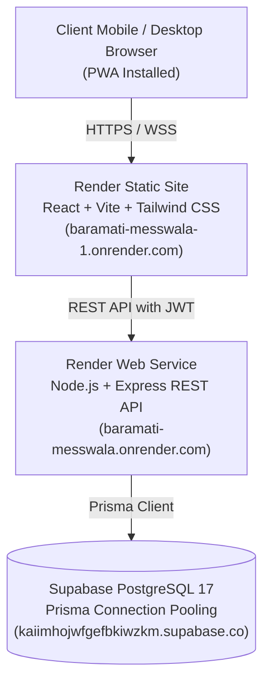

# MessMate – Project Overview

**Business**: Baramati Messwala (बारामती मेसवाला)  
**Location**: Near Vidyanagari, Baramati, Maharashtra 413133  
**Developer**: Devidas Pund  
**System Name**: MessMate – Smart Mess & Tiffin Management System  
**Repository**: [DevidasPund/Baramati-MessWala](https://github.com/DevidasPund/Baramati-MessWala)  

---

## 1. System Mission

MessMate is a smart mess, dining, and tiffin management solution created specifically for **Baramati Messwala**. It automates daily operations, eliminates paper-based attendance registers, prevents meal fee leakage, enables real-time QR attendance tracking, and provides transparent Marathi-first dashboards for both the mess owner and dining customers.

---

## 2. Core Stakeholders & Roles

| Role | Access Level | Primary Responsibilities |
| :--- | :--- | :--- |
| **Owner (Super Admin)** | Complete administrative authority | Customer verification & approval, QR scanner attendance, menu updates, invoice generation, offline/UPI payment confirmation, subscription management, grocery/expense tracking, business reports. |
| **Customer (Mess Member)** | Personal portal access | Personal dining QR pass, meal schedule, daily lunch/dinner menu, attendance record, monthly invoices, advance history, UPI payment submission with UTR tracking. |
| **Staff Member** | Deprecated / Blocked (403) | Per business requirements, staff login is blocked. All operational control resides with the mess owner. |

---

## 3. Technology Architecture

### 3.1 Frontend Tier
- **Framework**: React 18 with Vite for compilation and hot-reloading.
- **Styling**: Tailwind CSS with custom palette (Forest Green `#205D48`, Warm Cream `#FAF6ED`, Royal Blue accents).
- **Icons & Visuals**: Lucide React icon suite.
- **Charts**: Recharts dynamic vector visualizations.
- **Scanning**: HTML5-QRCode with camera facing-mode and torch integration.
- **Offline / PWA**: Web App Manifest and Service Worker caching.

### 3.2 Backend Tier
- **Runtime**: Node.js 20+ with Express REST framework.
- **ORM**: Prisma ORM with PostgreSQL driver.
- **Security**: bcrypt password hashing ($10$ rounds), JSON Web Tokens (7-day validity), Helmet security headers, rate limiting, and audit logging.
- **Exporting**: Excel export via `xlsx` buffer generation, PDF invoice generation via `pdfkit`.

### 3.3 Database Tier
- **Provider**: Supabase PostgreSQL 17.
- **Data Integrity**: Foreign key constraints, unique customer codes (`BMW-YYYY-NNN`), unique meal attendance constraints (`customerId + mealType + date`), and atomic multi-table transactions.

---

## 4. Key Business Features

1. **Dual-Method QR Attendance**:
   - *Method A (Counter Display)*: Mess displays a dynamic 10-minute rotating QR screen; customer scans via phone camera.
   - *Method B (Customer Dining Pass)*: Customer presents their personal QR code; owner scans with Android phone camera.
2. **Dedicated Tiffin / Dabba Tracking**: Tracks daily dabba given, returned, and lost counts with atomic attendance linking.
3. **Owner-Controlled Payment Verification**: Ensures no customer can self-confirm an unpaid bill. Invoices update to `PAID` only when the owner verifies the cash or UPI UTR reference.
4. **Mandatory First-Time Password Change**: New customers registered with their 10-digit mobile number must set a secure custom password upon first login.
