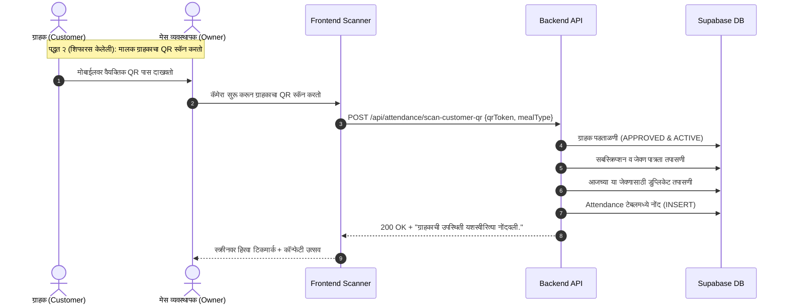

# MessMate – QR Attendance System Guide (QR हजेरी मार्गदर्शिका)

**Business**: Baramati Messwala (बारामती मेसवाला)  
**System**: Dual-Method QR Attendance Engine  

---

## 1. Overview of Attendance Architecture

MessMate features a dual-method QR attendance workflow that operates smoothly on desktop monitors, tablets, and Android mobile browsers:

---

## 2. Scanning Methods Detailed

### Method 2: Owner/Admin Scans Customer QR (पद्धत २ – प्राथमिक पद्धत)
1. **Admin Access**: Navigate to `/admin/qr-scanner`.
2. **Meal Selection**: Automatically selects Breakfast, Lunch, or Dinner based on current Indian Standard Time (can be manually toggled).
3. **Camera Initialization**:
   - Tapping **कॅमेरा सुरू करा** requests Android browser camera permissions.
   - Defaults to the environment (rear) camera lens.
   - If lighting is dim, tap the **फ्लॅश (Torch)** button to activate phone flashlight.
4. **Instant Verification**:
   - As soon as the customer's QR is in frame, HTML5-QRCode reads the token.
   - Displays customer name, member code, plan name, meal type, and exact timestamp.
   - Confetti animation confirms successful scan.
5. **Fallback Manual Token**:
   - If a customer's phone screen is cracked or camera cannot read, enter the token code (e.g. `bmw_qr_...`) in the manual input box and click **तपासा**.

---

### Method 1: Counter Mess Screen Display (पद्धत १ – स्वयं-हजेरी)
1. **Mess Counter Display**: Admin switches scanner mode to **पद्धत १: काउंटरवर मेस QR स्क्रीन दाखवा**.
2. **Rotating Security Token**:
   - The backend issues a 10-minute dynamic session token (`bmw_sess_...`).
   - Countdown timer refreshes the token automatically every 600 seconds.
   - Prevents proxy attendance or sharing screenshots outside the mess hall.
3. **Customer Self-Scan**:
   - Customer opens `/customer/scan-mess` on their smartphone.
   - Points phone at the counter display screen to mark attendance.

---

## 3. Business Validation Rules & Marathi Notices

| Scenario | System Action | Marathi Response Message |
| :--- | :---: | :--- |
| **Approved + Active Customer** | ✅ Attendance Recorded | `"ग्राहकाची उपस्थिती यशस्वीरित्या नोंदवली."` |
| **Pending Approval Customer** | ❌ Rejected | `"ग्राहक खाते अद्याप मंजूर झालेले नाही. उपस्थिती नोंदवता येणार नाही."` |
| **Suspended Customer** | ❌ Rejected | `"ग्राहक खाते निलंबित आहे. उपस्थिती नोंदवता येणार नाही."` |
| **Rejected Customer** | ❌ Rejected | `"ग्राहक खाते नाकारलेले आहे. उपस्थिती नोंदवता येणार नाही."` |
| **Inactive Account** | ❌ Rejected | `"ग्राहक खाते निष्क्रिय आहे. उपस्थिती नोंदवता येणार नाही."` |
| **Expired Subscription** | ❌ Rejected | `"सध्या कोणतेही सक्रिय सबस्क्रिप्शन उपलब्ध नाही. कृपया प्लॅनचे नूतनीकरण करा."` |
| **Meal Not in Plan (e.g. Dinner on Lunch plan)** | ❌ Rejected | `"आपल्या प्लॅन (...) मध्ये दुपारचे/रात्रीचे जेवण समाविष्ट नाही."` |
| **Duplicate Scan (Same Meal on Same Day)** | ❌ Rejected | `"आजच्या या जेवणाची उपस्थिती आधीच नोंदवली आहे."` |
| **Approved Meal Skip (सुट्टी)** | ❌ Rejected | `"ग्राहकाने दुपारच्या/रात्रीच्या जेवणासाठी सुट्टी (Skip) नोंदवली आहे."` |
| **Invalid or Malformed QR** | ❌ Rejected | `"अवैध QR कोड."` |

---

## 4. Mobile Camera Troubleshooting (Android)

1. **Camera Permission Denied**:
   - Click the lock/info icon in the Chrome URL bar.
   - Select **Permissions** $\rightarrow$ **Camera** $\rightarrow$ Change to **Allow**.
   - Refresh the page and tap **कॅमेरा सुरू करा**.
2. **Black Screen or Camera Busy**:
   - Close any other application currently using the camera (e.g., WhatsApp, Camera app).
   - Re-open the page.
3. **Screen Reflection / Glare**:
   - Ask customer to tap **फुलस्क्रीन दाखवा** on their QR page for maximum clarity.
